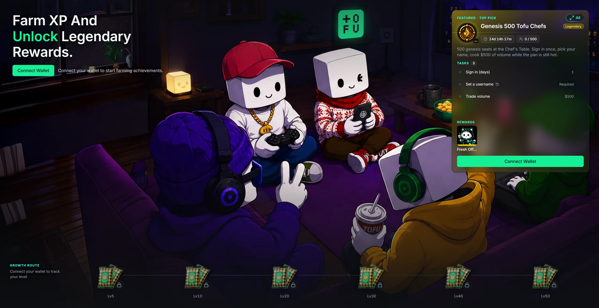

import detailShot from '../../../assets/screenshots/achievement-detail-genesis.png';
import rewardPack from '../../../assets/achievement/reward-pack.webp';
import emCommon from '../../../assets/achievement/emblem_common.webp';
import emRare from '../../../assets/achievement/emblem_rare.webp';
import emEpic from '../../../assets/achievement/emblem_epic.webp';
import emLegendary from '../../../assets/achievement/emblem_legendary.webp';

Farm XP. Unlock Legendary rewards. Every achievement is a quest with a receipt.

### What an achievement is

An achievement is a short checklist with a prize at the end. Clear the tasks, hit **Claim**, pocket the reward. Find them under **Achievement** in the top nav — the catalog is public, so you can window-shop before you even connect a wallet.

Every achievement carries a rarity, on the same palette as cosmetics:

Common → Rare → Epic → Legendary

  

    
  

  

    Open any achievement and you get the full card:

    * **Tasks** — one or several: sign in for N days, set a username, trade $X of volume, reach a level. The progress ring tracks the whole thing; each row shows your number against the target.
    * **Rewards** — items: avatars, frames, nameplates, danmaku styles, consumables. Tap a tile to inspect the product before you've earned it.
    * **Limits** — a deadline countdown, a seat cap (`0 / 500`), or both. Limited achievements are first come, first served — once seats are gone the card reads **Full**; past the deadline it reads **Ended**.
    * **Completers** — tap the seats pill to see who already made it in.
  

One detail worth knowing: a small history icon next to a task means it **counts all-time activity** — what you did before the achievement went live is already on the board. No icon means only activity inside the achievement's own window counts.

### The Growth Route

  

    
  

  

    Six reward packs sit along the bottom of the page, pinned to your level track: **Lv5 · Lv10 · Lv20 · Lv30 · Lv40 · Lv50**. The route line fills as you level; the pack you're chasing glows green. Reach the level, the pack lights up, you claim it. Tap any pack to see its **Pack contents** before you get there — no mystery, just motivation.
  

Pack rarity climbs with the level, and the default emblem tells you the tier at a glance:

  

    
    Level 5 · Level 10
    Common
  

  

    
    Level 20
    Rare
  

  

    
    Level 30 · Level 40
    Epic
  

  

    
    Level 50
    Legendary
  

### Featured & the full list

The hero shows one **Featured** pick — whatever deserves your attention most: something you can claim right now, then a running limited-seat event, then the next Growth pack. Hit **All** to expand the full catalog, grouped by **Growth · Onboarding · Trading · Social · Clan · Event**, with a **Status** filter for Claimable, In progress, Upcoming, Claimed, and Ended. Upcoming achievements show a countdown to their start, so you can line up early.

### Claiming

* **Claiming is manual.** When every task is done, the status flips to **Claim** — on the card, in the list, or on the Growth pack. Press it, the items land in [My Warehouse & My Bags](/dex/cosmetics/#my-warehouse--my-bags).
* **Completion gets celebrated.** A Common or Rare finish drops a toast; an Epic or Legendary finish takes over the screen with a full **Achievement Unlocked** reveal — same flash-and-rays language as opening a [Trading Drop](/dex/trading-drops/). Claim from there or hit Later.
* **Sign in required.** Anyone can browse the catalog, but progress and claiming need a signed-in wallet — see [Connect & Enable Trading](/dex/getting-started-connect/). Ghost Mode is read-only here.
* Your unlocked count shows on your profile banner, next to level and XP.

***Receipts or it didn't happen.***
