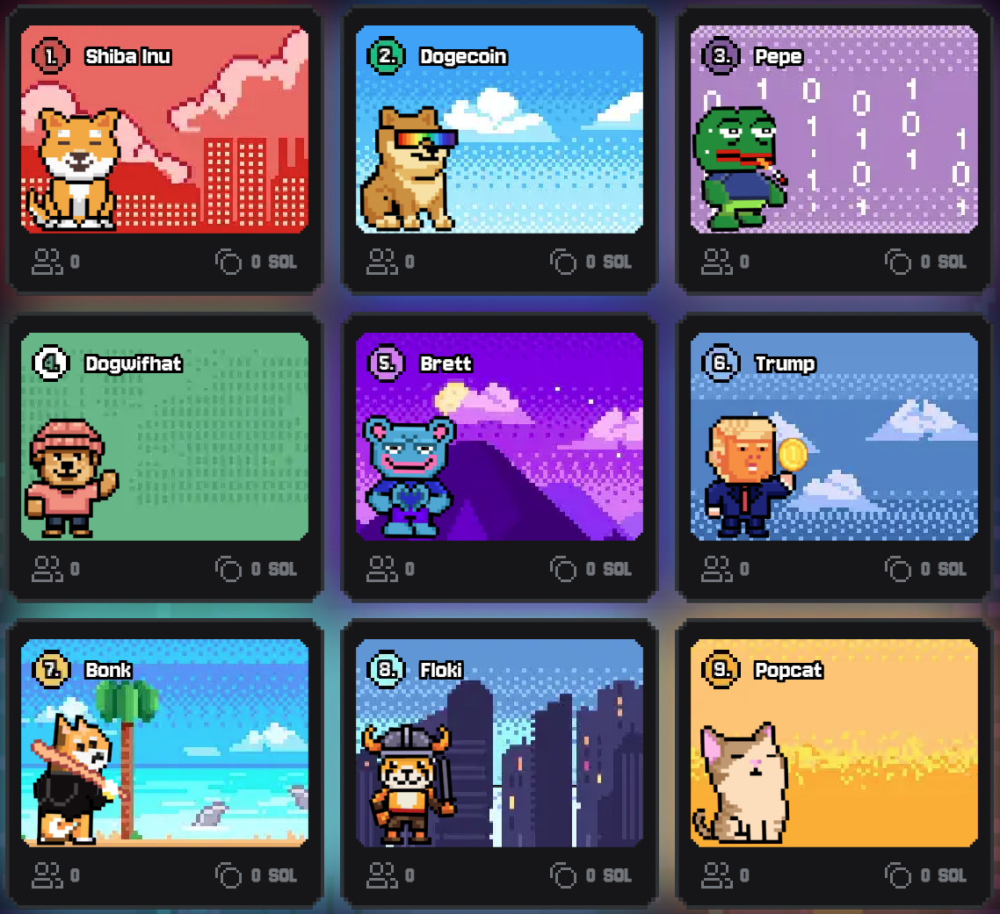

Before the Dex, there was the arena.

**RugPad Royale** was Together.fun's first chapter — a satirical, provably fair PvP simulation of the memecoin market on Solana. Nine meme-themed sectors, one on-chain VRF verdict, winners split the pot. It was our cultural on-ramp: it onboarded our earliest community, distributed XP and NFTs, and proved that trading mechanics can be genuinely fun.

### What RugPad established

* **Provable fairness** — every outcome decided by on-chain VRF, contracts audited by **Hashlock** ([audit report](https://hashlock.com/audits/together-fun)).
* **PvP, not house-vs-player** — wealth transferred between players, never printed against them.
* **The progression foundation** — XP, avatars, and NFT rarity tiers that now power the Dex's identity system.

### Your RugPad legacy carries over

RugPad has wrapped, but nothing you earned is lost:

* **XP is permanent**: every point accumulated in the RugPad era stays on your record — and it will count when it matters.
* **NFTs are remembered**: the type, rarity, and quantity of your RugPad NFTs are all part of that record.
* **Cross-platform identity**: your RugPad reputation and assets bridge to your Dex profile — early grinders get recognized.

*What that record unlocks is a story for another day. Follow [our X](https://x.com/togetherdotfun) — you'll want to be early to this one too.*
